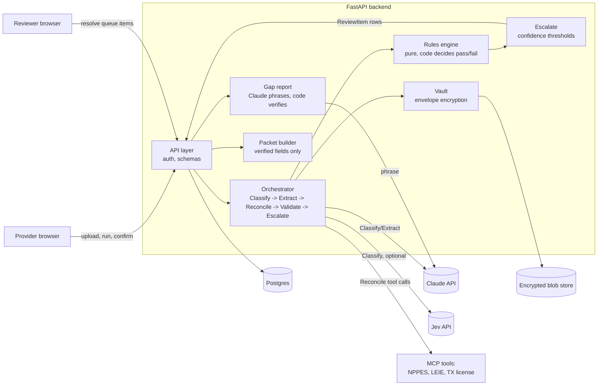

# nexus-clear: Credentialing Readiness Agent

A provider-facing tool for solo and small-practice Texas LPCs that answers: "Am I ready to be
credentialed with BCBSTX, and what is missing or wrong?" It checks uploaded documents against a
sourced rule pack, cross-checks them against public registries, explains every problem with cited
evidence, routes uncertain findings to a human reviewer, and produces a pre-filled packet the
provider reviews and confirms is accurate. **This is not CAQH attestation** - CAQH has its own,
separate attestation step, and the provider still has to log into CAQH and attest there (M9.1 #2;
see "Payer authorization and other CAQH steps" below for the full list of what this app does not
cover).

## What this is - and is not

- **All data is synthetic.** Every packet, name, NPI, and LEIE exclusion row is generator-produced
  from a fixed seed (`app/eval/generator/`). Nothing here is a real person's information.
- **It never submits anything to a payer**, and **it never writes to CAQH/DataSpring**. There is
  no code path that can confirm the packet on a provider's behalf (enforced by a test, not just a
  convention -
  `backend/tests/api/test_m8_acceptance.py::test_attest_requires_an_explicit_confirmation_payload` -
  internal test/endpoint/field names still say "attest"; only user-facing copy changed, M9.1 #2).
- The packet it produces is explicitly labeled **"CAQH-style"** - a prefilled profile assembled
  from fields the system has *verified* against document text, not a claim of compatibility with
  the real CAQH/DataSpring schema (which was never reverse-engineered or tested against).
- It is an MVP built for a hiring interview, not a production system. See "Honest limitations"
  below for what that means concretely.

## Architecture



Stage order: **Classify** (Jev or Claude, which document type is this) → **Extract** (Claude,
value/confidence/page/quote per field, citation-verified in code) → **Reconcile** (exact name
matches resolve in code; ambiguous ones and every registry lookup go to a Claude investigator agent
with a hard tool-call limit) → **Validate** (pure rules engine, code decides pass/fail, zero model
involvement) → **Escalate** (confidence thresholds route uncertain findings to a reviewer queue) →
**Report/Confirm** (Claude phrases plain English, code verifies every date/number/name against
evidence before trusting it; confirming the packet is accurate is an explicit provider action -
not CAQH attestation, which still happens separately in CAQH - gated on no open blockers and no
run predating a later upload or review resolution).

## How to run

```
docker compose up
```

Serves the backend on `:8000` (migrates on startup) and the frontend on `:5173`. Postgres and the
vault's encrypted blob store persist in named volumes.

Without Docker, from `backend/`:

```
uv sync
uv run alembic upgrade head
uv run uvicorn app.main:app --reload
```

And from `frontend/`:

```
npm install
npm run dev
```

### Env vars

| Var | Default | Meaning |
| --- | --- | --- |
| `ANTHROPIC_API_KEY` | - | Required for any live Claude call (Classify/Extract/Reconcile/Report). |
| `JEV_API_KEY` | unset | Optional. Jev only ever appears in Classify (see limitations) - unset means Classify runs on Claude alone, satisfying `DECISION_BACKEND=claude` end to end. |
| `DECISION_BACKEND` | `claude` | `jev` or `claude`. |
| `MODEL_CLASSIFY_FALLBACK`, `MODEL_EXTRACT`, `MODEL_INVESTIGATE`, `MODEL_REPORT` | `claude-haiku-5-5` | Pinned model IDs, never an alias like `-latest`. |
| `MODEL_CACHE_MODE` | `replay` | `replay` (offline, CI default - a cache miss is a loud error, never a silent live fallback) or `record` (make real calls, refresh the cache). |
| `MCP_TOOL_MODE` | `fixture` | `fixture` (deterministic JSON fixtures) or `live` (real NPPES/LEIE - synthetic providers won't exist there, so this only demonstrates not-found handling). |
| `MASTER_KEY` / `MASTER_KEY_PATH` | unset / `data/vault/master.key` | Vault master key - see the key management caveat below. |
| `REVIEWER_TOKEN` | `demo-reviewer-token` | The one shared reviewer-role secret. Change it if you expose this past localhost. |

### Fixture vs. live mode

Every LLM/Jev call goes through a record/replay cache keyed on `(backend, model, prompt
fingerprint, input)` (`app/backends/cache.py` and friends). `MODEL_CACHE_MODE=replay` (the test/CI
default) never touches the network - a cache miss raises loudly instead of silently calling out.
`MODEL_CACHE_MODE=record` makes real calls and writes genuine responses into
`eval/fixtures/model_cache/` for next time. Every fixture committed to this repo came from a real
live call at some point - none were hand-edited or derived; see each milestone's completion notes
for exactly when.

## Demo script (~5 minutes)

1. The problem and Carepatron's guarantee clock (30s).
2. Start a case; show the personalized checklist (30s).
3. Upload a defective packet; instant per-document feedback catches the wrong document (45s).
4. Run: score, blockers with cited evidence, "needs verification" markers on rules with weak
   provenance (60s).
5. The ambiguous name match lands in the reviewer queue; resolve it (45s).
6. Fix, re-run, confirm the packet is accurate, download the packet (45s).
7. Eval dashboard: defect precision/recall, Jev vs. Claude cost/latency/calibration, and what the
   human corrections would feed (60s).

Close with what's next: monitoring, a second payer, a rule-pack builder agent, distillation from
reviewer corrections.

## Eval results (live runs, 2026-11-05, seed `20261103`, rule pack `0.2.0`)

15 packets: 2 clean, 5 benign (including 3 added specifically to stress-test the ambiguous-name
confidence band - a hyphenated surname, a middle initial, a generational suffix), 8 defective
covering defect catalog D01-D15.

### Validate (rules engine only)

| mode | exact match | primary defect detected | false positives (clean/benign) | coverage | accuracy when decided |
| --- | --- | --- | --- | --- | --- |
| ceiling (ground-truth CaseFacts, no extraction) | 100.0% | 100.0% | 0 | 100.0% | 100.0% |
| baseline (regex extraction, no LLM) | 60.0% | 87.5% | 0 | 95.1% | 100.0% |
| end_to_end (the real pipeline) | 80.0% | 100.0% | 2 (1.0%) | 98.2% | 99.5% |

The 2 end-to-end false positives are both the "middle initial" benign packet (`Robert Chen` vs.
`Robert J. Chen`): the real Claude investigator resolved that name pair at confidence 0.88, just
under the rule pack's 0.90 threshold for an exact pass - a genuine, not manufactured, miss. It is
exactly the case Escalate exists for: `blocker_low_confidence` routes it to the reviewer queue
(confirmed via `app/eval/escalate_run.py`'s live-checked precision/recall below), where a human
correctly overrides it to pass. The other two name variants (hyphenated surname, suffix) resolved
confidently (0.95, 0.90) and never reached review at all - a real, not engineered, split result.

### Classify (n=75 main set, n=29 adversarial hard set)

| mode | n | accuracy | ECE | cost | mean latency |
| --- | --- | --- | --- | --- | --- |
| classify-jev | 75 | 100.0% | 0.020 | n/a (unpublished pricing) | 206 ms |
| classify-claude-haiku | 75 | 100.0% | 0.038 | $0.0087 | 1342 ms |
| classify-claude-sonnet | 75 | 100.0% | 0.064 | $0.1564 | 1409 ms |
| classify-claude-opus | 75 | 100.0% | 0.080 | $0.3182 | 1937 ms |
| classify-claude-haiku-hard (n=29) | 29 | 100.0% | 0.103 | $0.0043 | 1725 ms |
| classify-jev-hard (n=29) | 29 | 100.0% | 0.151 | n/a | 210 ms |

### Extract (n=44 main-set documents, n=2 vision, n=30 hard set)

| mode | n | coverage | accuracy when known | cost |
| --- | --- | --- | --- | --- |
| extract-claude-haiku | 44 | 97.7% | 100.0% | $0.0181 |
| extract-claude-sonnet | 44 | 97.7% | 100.0% | $0.2909 |
| extract-claude-opus | 44 | 97.7% | 100.0% | $0.6133 |
| extract-claude-haiku-vision (n=2 scans) | 2 | 50.0% | 100.0% | $0.0011 |
| extract-claude-haiku-hard (n=30) | 30 | 98.5% | 100.0% | $0.0127 |

Quote-verified rate is 100% everywhere text exists to check against; 0% for the two vision-only
scans, by construction (no text layer, so `quote_verified` correctly stays false even for a
correctly-read field - see "Pre-M9 fix #1" in the commit history).

### Escalate (n=450 findings across all 15 packets)

| total findings | escalated | escalation rate | precision | recall |
| --- | --- | --- | --- | --- |
| 450 | 5 | 1.1% | 1.00 | 1.00 |

Precision/recall are scored against this corpus's 5 known escalation-relevant cases (two genuine
name mismatches, the middle-initial case above, a synthetic LEIE possible-match, an injected-
instruction CV) - see `app/eval/escalate_run.py`'s own docstring for exactly what is and isn't
covered by this ground truth.

No row above is simulated - every number came from a live model call, confirmed via each fixture's
own recording (`app/eval/classify_run.py`/`extract_run.py` would append `-SIMULATED` to any mode
built from a placeholder, in both the table and the JSON run file).

## Honest limitations

- **Easy synthetic corpus.** The generator renders clean "Label: value" layouts
  (`app/eval/generator/documents.py`). The hard classify/extract sets (adversarial lookalikes,
  narrative prose, multi-page documents) are a stress test, not a substitute for real-world
  document variety - a production system would need a much larger and messier training/eval
  corpus before trusting these numbers on real intake.
- **Jev appears only in Classify.** Extract, Reconcile, and Report are Claude-only in this MVP -
  SPEC originally sketched a Jev `same_person` pre-filter ahead of the Reconcile investigator;
  it was never built (a stretch goal, SPEC.md section 17), and `DECISION_BACKEND=claude` runs the
  whole pipeline end to end with zero Jev involvement by design (a tested invariant, not an
  accident).
- **Rule-pack currency.** `rules/tx_bcbstx_lpc.yaml` is dated and sourced, but several entries are
  explicitly flagged `needs_verification: true` and must stay visibly marked wherever they
  surface, never presented as settled payer policy: `R-COI-002` (COI limits), `R-WORK-001` (CV gap
  rule), `R-PATH-001` (CAQH/TSCA path routing), plus three required slots (`cv`, `education`,
  `w9`). The NPI Luhn/80840 checksum algorithm and the BCBSTX checklist's own currency were
  verified against public sources at build time, not re-verified since.
- **Demo-grade auth.** A per-case provider token (shown once, at case creation) and one shared
  reviewer secret (`REVIEWER_TOKEN`) are the entire auth model (`backend/app/api/auth.py`) - proof
  of possessing a token, not real identity verification, session management, or authorization
  scoping. Do not expose this past localhost without replacing it.
- **Key management caveat.** The vault's master key (`app/vault/key_manager.py`'s
  `LocalKeyManager`) loads from the `MASTER_KEY` env var (base64, 256-bit) when set, falling back
  to a local file (`MASTER_KEY_PATH`, generated on first use, mode 0600) when it isn't. Neither
  path is a production key-management story: a real deployment should source the master key from
  a KMS/Secrets Manager/Vault directly, with rotation and access-logging on the key itself - not a
  long-lived raw key sitting in a process's environment or on a container's disk. Treat both as
  dev/demo-only.
- **Orchestrator is a single synchronous pass**, not the durable, idempotent-per-stage state
  machine SPEC section 7.10 describes - re-running a case adds new rows rather than resuming a
  partial one. Fine at demo scale; not how a production credentialing pipeline would be built.
- **MCP tools default to FIXTURE mode.** `tx_license_lookup` (BHEC) has no verified programmatic
  access and only ever runs in fixture mode; `nppes_lookup`/`leie_check` can run live against the
  real public NPPES API / LEIE CSV, but synthetic providers won't exist there - live mode only
  demonstrates not-found/`indeterminate` handling, not a real eval path.

## Security and privacy notes

- Synthetic data only, built as if it were real: envelope encryption at rest
  (`app/vault/key_manager.py`, `app/vault/aead.py`), SSN/EIN-shaped redaction before anything
  reaches a model or a log line (`app/core/redact.py`), an append-only audit log (DB trigger-
  enforced, not just convention), and a documented rule that document text, extracted PII, and
  secrets never appear in `audit_log.detail` or process logs (tested directly, not just assumed -
  `backend/tests/api/test_synthetic_packets.py`).
- Documents are treated as untrusted input end to end: every prompt that includes document or tool
  output explicitly frames it as data, never instructions, and `app/core/injection.py`'s
  deterministic detector - not a model's own say-so - decides whether an injection attempt is
  flagged (CLAUDE.md invariant 1: no model output sets a rule's pass/fail or presence decision).
  `tests/backends/test_d14_injection_immunity.py` and
  `tests/reconcile/test_investigator_injection.py` prove an injected instruction inside a CV, or
  inside a tool's own JSON response, never changes what gets extracted or concluded.
- No code path submits to a payer, scrapes a payer portal, or bypasses CAPTCHA/bot detection - none
  of that exists in this codebase at all.
- Extraction sends page images/text to the Claude API, and Classify may send them to Jev: a real
  deployment would need to review each vendor's data retention terms and sign appropriate
  agreements before sending genuine provider documents - not a concern synthetic data raises, but
  a real one for anyone adapting this.
